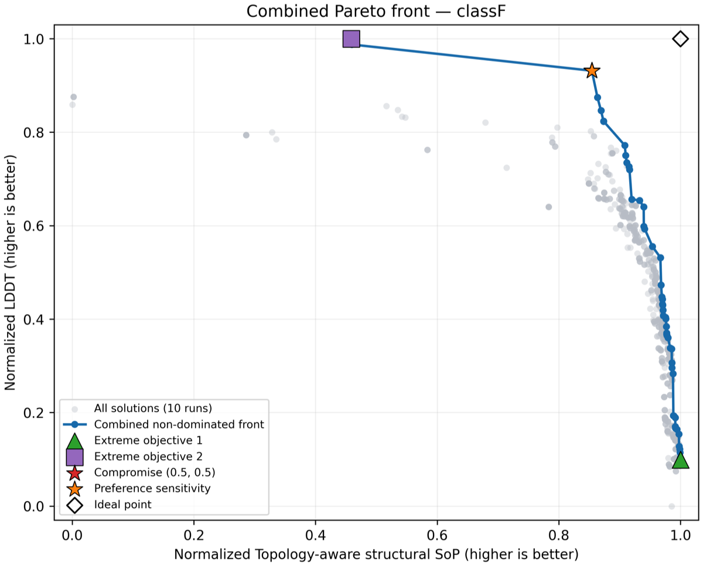

# T3. A Study With Several Seeds

| | |
| --- | --- |
| **Level** | Intermediate |
| **Version** | 1.0 (2026-11-04) |
| **Time** | about 20 minutes, plus 10 runs of about 10 seconds each |
| **Timings measured on** | Apple M5 Pro (18 cores), 64 GB of RAM, macOS 26.6.2, Java 21.0.12 (Oracle JDK), Python 3.9 with NumPy and Matplotlib 3.9 |
| **Prerequisites** | [T1. First run in five minutes](T1-first-run.md), [T4. Choosing an alignment](T4-choosing-and-evaluating.md) |

The search is stochastic: two runs with different random seeds return different alignments. A
study therefore runs the same configuration with several seeds and analyses the runs together.
This tutorial runs 10 seeds on `classF` with a reduced budget, combines their fronts, measures how
much the runs differ, and picks alignments from the combined front.

## Step 1: run 10 seeds

On Linux or macOS:

```bash
for seed in 0 21 42 63 84 105 126 147 168 189; do
  java -jar target/TM-MSAStructAligner-1.0-jar-with-dependencies.jar run \
    --data-root ../Dataset_Structural_GPCRs/GPCRdb --dataset classF \
    --seeds clustalw,kalign,mafft,muscle5,tcoffee,tmaligner \
    --output-root results --run-id seed_$(printf %03d $seed) --seed $seed \
    --max-evaluations 2500 --population-size 100 --threads 4
done
```

On Windows, `scripts/run_10_seeds_windows.ps1` does the same with the same seeds (run identifiers
`run_01` ... `run_10`), and checks that every run wrote its files:

```powershell
.\scripts\run_10_seeds_windows.ps1 -JarPath target\TM-MSAStructAligner-1.0-jar-with-dependencies.jar `
  -DataDirectory ..\Dataset_Structural_GPCRs\GPCRdb -ProblemName classF -OutputRoot results `
  -SeedMethods clustalw,kalign,mafft,muscle5,tcoffee,tmaligner -MaxEvaluations 2500
```

Each run takes about 10 seconds. The budget of 2 500 evaluations keeps the tutorial short; a real
study uses more (Step 6).

## Step 2: analyse the runs together

`scripts/pareto_analysis.py` reads every run of a dataset under `results/ejecuciones/` (it needs
Python 3 with NumPy and Matplotlib):

```bash
python3 scripts/pareto_analysis.py results classF --output results/analysis_classF
```

```text
Analyzed 1000 solutions from 10 runs
Combined non-dominated objective vectors: 51
Balanced compromise: seed_189/MSASol1.fasta
Results: results/analysis_classF
```

It writes:

| File | Content |
| --- | --- |
| `combined_solutions.csv` | Every solution of every run, with its objectives normalised over all the runs |
| `combined_pareto_front.csv` | The non-dominated solutions of the union of the runs |
| `indicators_by_run.csv` | Quality indicators of every run (Step 3) |
| `indicator_summary.csv` | Median and interquartile range of each indicator over the runs |
| `selected_solutions.csv`, `selected_alignments/` | The alignments chosen from the combined front (Step 4) |
| `pareto_front_classF.{png,svg,pdf}` | The figure below |



The grey points are the 1 000 final solutions; the blue line is the combined non-dominated front.
Both objectives are scaled to [0, 1] over all the runs, so that they can be compared.

## Step 3: how much do the runs differ?

`indicators_by_run.csv` measures every run against the combined front:

| Indicator | Meaning | Better |
| --- | --- | --- |
| `hypervolume` | Area dominated by the run's front in the normalised objective space | Higher |
| `igd_plus` | Distance from the combined front to the run's front | Lower |
| `nondominated_solutions` | Distinct non-dominated solutions of the run | |
| `combined_front_contribution` | Solutions of the run that are on the combined front | |
| `reached_compromise_region` | Whether the run has a solution almost as close to the ideal point as the balanced compromise (within `--epsilon`, 0.05) | |

```text
run       hypervolume  igd_plus  nondominated  contribution
seed_000  0.772        0.026     17             6
seed_021  0.639        0.057     35             5
seed_042  0.705        0.046     37             0
seed_063  0.622        0.057     25             8
seed_084  0.621        0.057     34             18
seed_105  0.866        0.013     34             29
seed_126  0.749        0.031     36             25
seed_147  0.684        0.043     31             18
seed_168  0.686        0.046     30             31
seed_189  0.880        0.009     45             24
```

The hypervolume goes from 0.62 to 0.88 (median 0.70, interquartile range 0.12), and one run
(`seed_042`) contributes nothing to the combined front. A conclusion drawn from a single run
would depend heavily on the seed: this is why studies use 10 or more, and report medians and
spreads instead of single values.

## Step 4: choose alignments from the combined front

`selected_solutions.csv` lists four alignments of the combined front, copied to
`selected_alignments/`:

| Selection | Rule | Run / row | SOPwTP | lDDT |
| --- | --- | --- | --- | --- |
| `extreme_f1` | Best SOPwTP | seed_189 / 0 | 61 341 | 0.5664 |
| `extreme_f2` | Best lDDT | seed_105 / 1 | 43 912 | 0.6150 |
| `compromise_balanced` | Closest to the ideal point with weights (0.5, 0.5) | seed_189 / 1 | 56 644 | 0.6113 |
| `compromise_sensitivity` | The same with weights (0.7, 0.3) | seed_189 / 20 | 56 649 | 0.6113 |

The weights are options of the script (`--weight-f1`, `--weight-f2`, and
`--sensitivity-weight-f1`, `--sensitivity-weight-f2`). Here both compromises are practically the
same alignment, which is a sign that the choice is robust to the weights.

Evaluate them against the GPCRdb reference as in [T4](T4-choosing-and-evaluating.md):

```bash
java -cp target/TM-MSAStructAligner-1.0-jar-with-dependencies.jar \
  org.tmm2structalign.evaluation.EvaluationMain \
  --reference ../Dataset_Structural_GPCRs/GPCRdb/reference_alignments/classF.fasta \
  --topology ../Dataset_Structural_GPCRs/GPCRdb/sequences/tmregions/classF_predicted_topologies.3line \
  --msa-root results/analysis_classF/selected_alignments --glob '*.fasta' \
  --output results/evaluation_selected_classF.csv
```

```text
compromise_balanced.fasta     Pair-F1=0.556683  TM-Pair-F1=0.999820  TM-gap-rate=0.004091
compromise_sensitivity.fasta  Pair-F1=0.556683  TM-Pair-F1=0.999820  TM-gap-rate=0.004091
extreme_f1.fasta              Pair-F1=0.539880  TM-Pair-F1=0.999460  TM-gap-rate=0.006080
extreme_f2.fasta              Pair-F1=0.485455  TM-Pair-F1=0.894802  TM-gap-rate=0.016705
```

As in T4, the compromise is the best of the four and the best-lDDT extreme the worst: it pays for
its structural score with gaps inside transmembrane helices.

## Step 5: compare with the seeds

The combined front is only interesting if it improves on the starting alignments. Evaluate the
seeds as in [T4, Step 5](T4-choosing-and-evaluating.md#step-5-compare-with-the-seeds): on
`classF` the compromise (pair F1 0.5567) is better than five of the six seeds, and slightly worse
than ClustalW (0.5598).

## Step 6: towards a real study

This tutorial uses a small budget and one small dataset. A study meant for publication should
also:

- **Use a larger budget** (`--max-evaluations`), and check with `progress.jsonl` that the best values
  have stopped improving before the end.
- **Run more datasets.** Runtime grows with the square of the number of proteins and with their
  length: the `_19` variants (19 proteins) are a good intermediate step before the full classes.
- **Fix everything in advance and keep the metadata.** Every run records its configuration
  (`config.json`) and provenance (`metadata.json`: git commit, SHA-256 of the seeds, mapping of
  the structures). Keep them with the results.
- **Compare against baselines**, such as the seeds themselves and the random searches of
  [T5](T5-comparing-algorithms-and-operators.md).

To repeat the published experiments, use the settings of the article (budget, population, seeds)
together with `--mapping-policy LEGACY`: the original implementation mapped the AlphaFold models of
OXER1 and MCHR1 incorrectly, and the default policy fixes it, which changes the lDDT in
`classA_002`, `classA_004` and `classA_004_19`. Even then, the results will not be identical bit
for bit, because the version of jMetal used by the article consumed random numbers differently;
they should agree statistically.
